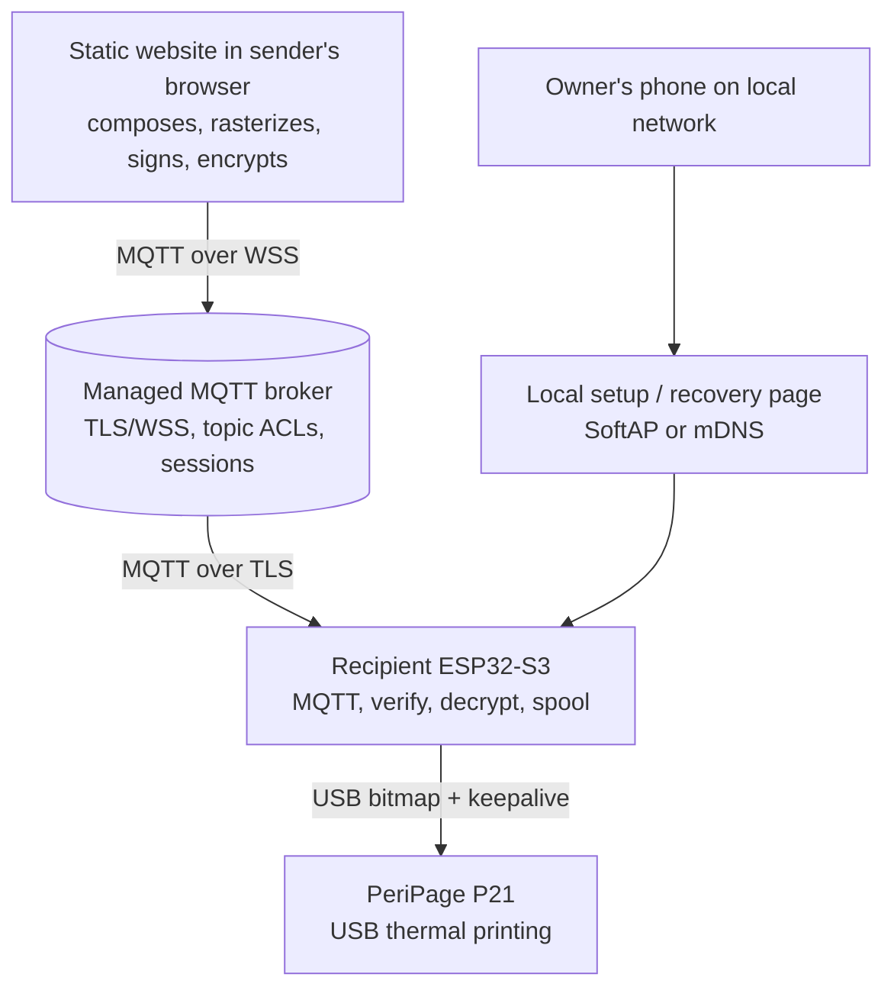

# System architecture

## Logical system

The browser and printer each initiate *outbound* connections to the broker; there is no direct internet connection to an ESP32 and no port forwarding. The creator's VPS plays no role.

## Responsibilities

### Static browser composer

- Establishes a session with the MQTT broker using the browser owner's scoped credentials.
- Obtains a protected membership/public-key directory.
- Selects the destination printer and prepares a print-ready monochrome raster.
- Encrypts the payload for the **recipient printer's** encryption public key.
- Signs the message with the **sending browser's** private signing key.
- Publishes directly to the recipient's MQTT inbox and reports meaningful progress where available.
- Does not require the sender's printer to be online.

### MQTT broker

- Authenticates browser and device clients.
- Enforces topic publication/subscription permissions and restricts authoritative directory updates.
- Delivers publications to subscribed printer devices.
- Can queue QoS 1 publications while a printer is disconnected when its persistent session, retention, limits, and provider policy permit.
- Holds retained membership and public-key records, if that directory approach is adopted.
- Carries enrollment requests, key approvals/revocations, presence, acknowledgments, and management commands.

The broker need not understand the bitmap or decrypt its contents. It does see topics, timing, sender credential identity, message sizes, and other metadata.

### ESP32-S3 device

- Maintains home Wi-Fi, a temporary recovery AP, local administration, an MQTT client, and identity/persistent settings.
- Maintains the private encryption key for the recipient printer.
- Authoritatively approves or revokes its owner's browser signing keys.
- Receives messages, validates authorization/signatures, decrypts, avoids duplicates, and manages printing.
- Drives the P21 over USB and sends its tested USB keepalive traffic.
- Provides diagnostics and authenticated firmware update support.

### PeriPage P21

The thermal printer is an output peripheral, not an internet node. The ESP32 controls it directly using its USB interface. The newer USB design replaces the earlier proposed BLE attachment and BLE keepalive.

## Direct-send behavior, including disconnected printers

Assume Bob opens the website to send Alice an image:

1. Bob's browser authenticates as Bob to MQTT over secure WebSockets.
2. The browser finds Alice's printer encryption public key and Bob's own authorized browser signing key.
3. It prepares the bitmap, encrypts it for Alice, signs the envelope, and publishes to Alice's MQTT inbox.
4. If Alice's ESP32 is online, it receives the publication, verifies/decrypts it, and prints.
5. If Alice's ESP32 is offline, the broker may retain the publication for its persistent session; Alice receives it when she reconnects, *subject to broker limits*.

**Bob's ESP32 never has to participate in this path.** If Bob's device is offline but Alice's is online, the message still works; if both printers are offline but Bob's browser has internet access, the broker may accept and queue the job. If the **broker itself** is unavailable, this architecture has no built-in durable offline send from the browser: the send fails or must be retried while the browser is available.

The distinction between *broker accepted*, *printer received*, and *paper printed* is important. Only the ESP32 can report the latter two, and even it may not be able to confirm physical paper output conclusively.

## Control plane versus data plane

- **Data plane:** browser publishes encrypted bitmap; broker forwards; printer decrypts and prints.
- **Control plane:** membership, public encryption keys, authorized browser signing keys, one-time enrollment, status, blocklists, administrative commands, and firmware update signals.

These can share a broker but must have distinct topic permissions. In particular, a normal browser must not be able to publish authoritative enrollment approvals, edit other members' keys, or issue device-administration commands.

## Centralization tradeoff

The system is *not* peer-to-peer: a single managed broker remains essential for cross-household delivery. It is nevertheless distinct from a creator-operated centralized messaging backend: the site can be static, each printer manages its own keys and print hardware, and no VPS process or database is required. Replacing the MQTT provider is possible in principle but requires migrating identities, credentials, routing state, and potentially pending messages; provider-independent failover was explicitly deferred.
