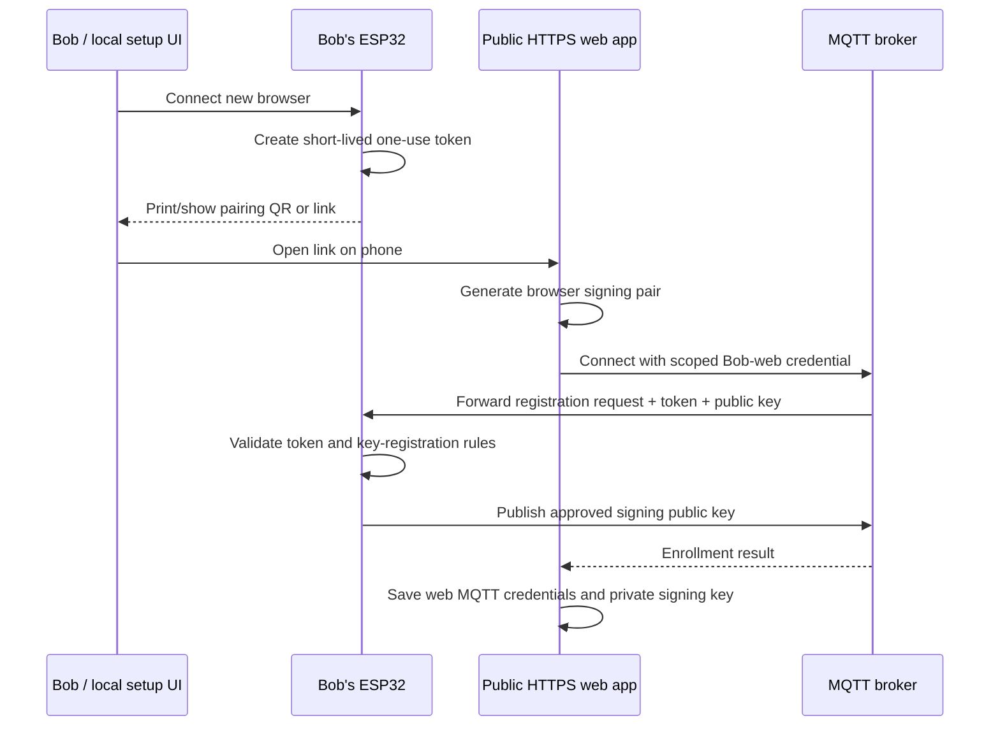

# Membership, credentials, and browser enrollment

## Two different onboarding events

**Joining the network as a new person** is creator-controlled: the creator prepares a printer, provisions its MQTT identity and ACLs, and adds the owner to a protected member directory.

**Adding another browser for an existing person** is owner-controlled: the person uses their own printer's local configuration interface to grant a new browser signing identity. No creator approval and no exchange of public keys by chat are required.

This distinction makes invitation-only membership compatible with self-service recovery and adding new phones/laptops.

## New member / new printer

Illustrative example: the creator gifts Charlie a P21 with an ESP32 already assigned to Charlie.

- A provisioning process creates **device MQTT credentials** and limited **browser MQTT credentials**, with separate permissions.
- The ESP32 receives a stable printer/member ID, a trusted broker endpoint and device credentials, and whatever protected configuration is needed to operate independently.
- At first device initialization, its printer encryption key pair is generated and the public key is published under its protected identity. The private key is never required by the creator or broker.
- The member directory gains Charlie's preferred display name/ID and public metadata; other clients can see Charlie without updates to existing firmware.
- Charlie connects the appliance to his Wi-Fi through the local setup AP and can then enroll browsers.

The exact provisioning tooling and provider API are **not specified**; a creator-operated script was discussed as a convenient mechanism. Unattended public account creation is not part of this private network.

## First-time browser enrollment — agreed concept

The link/QR can carry a short-lived token plus scoped **web** MQTT bootstrap credentials, for example using a URL fragment (`#enroll=...`) so the fragment is not included in the HTTP request URL. This is a bearer secret: someone with the QR can attempt enrollment until it expires; the page, browser history and extensions can see the fragment. The token must be single-use, time-limited, and valid only for Bob's device.

The initial phone usually connects to the ESP32's AP, which may have **no internet**. It may need to return to home Wi-Fi/mobile data before opening the public HTTPS site. The setup page can display the same enrollment link for manual copying, and the printer can print a QR; the two are alternative presentations of the same pairing operation.

## Ordinary reuse

Once enrolled, the same browser stores a private signing key and the necessary web MQTT credentials. On future visits it loads the static website, reconnects to MQTT, and can send without pairing again.

Each browser/profile/device gets an independent signing key. Losing a phone does not invalidate the owner's printer decryption key and does not require reflashing or creator intervention.

## Authority over browser signing keys

**Final preferred authority model:** a browser only requests registration. The owner's ESP32 validates the one-time pairing token and publishes the authoritative approved signing-key record.

Why this matters: if every Bob browser could publish its own authoritative key, revoking a stolen phone key would not help while that browser retained Bob's shared MQTT account credentials; it could just add a new signing key. Delegating approvals to the printer makes adding an approved key require access to the local setup procedure.

The browser may retain a still-valid shared MQTT credential after signing-key revocation. The broker might continue accepting its publications, but recipients must **reject signed jobs whose key is no longer authorized**. For stronger credential revocation, rotate the web MQTT credential and/or provision independent browser credentials (a possible later refinement).

## Recovering from loss of every browser

The printer retains a way to bootstrap another browser, independently of previous browser storage. An owner opens the local recovery UI (typically via temporary setup AP), authenticates with a device-specific setup secret, selects browser enrollment, and obtains a new pairing QR/link. The old browser signing private keys do not need to be recovered. Owner intervention is physical/local; creator coordination is unnecessary while the printer and its permanent MQTT identity still work.

Browser recovery is *not* a factory reset and should not erase printer encryption keys, pending messages, or MQTT device credentials. If compromised browser credentials need to be invalidated at the broker, that is a separate credential-rotation operation.

## Member directory

A retained, protected MQTT directory was preferred over hardcoding friends into the website or firmware. It can include stable member IDs, display names, and pointers to public encryption/verification-key records. New clients receive the current snapshot; connected clients see updates.

The creator must remain the authority for adding new **members**, while each printer controls its own **authorized browser keys**. The exact message shape, member removal semantics, key-versioning, and provider-specific ACL rules remain open.
